<!-- hello, fellow view-source enjoyer. the terminal is drawn by scripts/render_terminal.py -->

  

<pre>
<b>UJJWAL(1)</b>                       User Commands                        <b>UJJWAL(1)</b>

<b>NAME</b>
       ujjwal - builds AI agents that still work after the demo

<b>SYNOPSIS</b>
       <b>ujjwal</b> [<b>--agents</b>] [<b>--rag</b>] [<b>--backend</b>] <i>problem</i>

<b>DESCRIPTION</b>
       AI agent &amp; automation engineer in New Delhi. B.E., BITS Pilani.
       Builds multi-agent systems, RAG pipelines and backends that run in
       production. Led AI for a research platform with BITS Pilani and
       India's Ministry of Tribal Affairs, over 100K+ government documents.

<b>SEE ALSO</b>
       <a href="https://whyujjwal.com">whyujjwal.com</a>(7), <a href="https://in.linkedin.com/in/ujjwal-raj-2019b5181">linkedin</a>(1), <a href="https://x.com/whyujjwal">x</a>(1)
</pre>

<pre>
<b>$ ls ~/projects</b>
<a href="https://github.com/whyujjwal/claude-marketing">claude-marketing/</a>           ★17  marketing co-founder for Claude Code
<a href="https://github.com/whyujjwal/AgentOptimisedMonorepo">AgentOptimisedMonorepo/</a>     ★8   monorepo built for humans + AI agents
<a href="https://github.com/whyujjwal/reddit-marketing-agent">reddit-marketing-agent/</a>          Reddit marketing agent (MCP server)
<a href="https://github.com/whyujjwal/mcpflight">mcpflight/</a>                       flight recorder for MCP servers
<a href="https://github.com/whyujjwal/warden">warden/</a>                          control plane + audit trail for agents
<a href="https://github.com/whyujjwal/repoexec">repoexec/</a>                        GitHub-native runner for coding agents
<a href="https://github.com/whyujjwal/bitsians-map">bitsians-map/</a>                    companies founded by BITS alumni
</pre>

<pre>
<b>$ git log --oneline career</b>
5f8ab99 Lead Developer @ SmartQnA (2025-26): +40% answer relevance with RAG
522312e Senior SWE @ Aadi-Vaani (2024-25): RAG over 100K+ government docs
e1ad067 Lead Backend @ CogniX (2024): -60% model latency, -45% resources
20e1a24 Initial commit: B.E. @ BITS Pilani
</pre>
